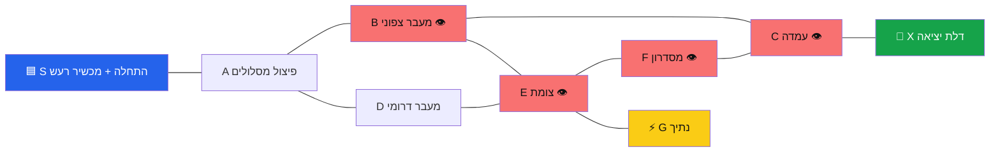
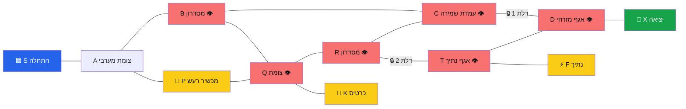
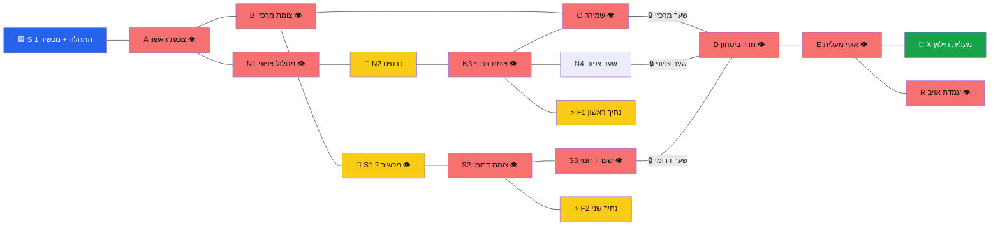

# תכנון רמות – רעש שמציל | SOUND OF SURVIVAL

**חברי הצוות:** אביתר אהרון, כפיר נזרי  
**מטלה 3 – חלק א': תכנון רמות**

---

## מבנה הרמות

המשחק הוא משחק הישרדות, התגנבות וחשיבה דו־ממדי במבט מלמעלה. השחקן מנסה לצאת ממתקן מחקר חשוך. כדי לראות קירות, אויבים וחפצים עליו ליצור גלי קול, אבל אותם גלים מושכים אליו אויבים עיוורים. המטרה היא לבחור מתי לחשוף את הסביבה, מתי להתקדם לפי הזיכרון, ומתי להרחיק אויבים בעזרת מכשירי רעש חד־פעמיים.

ארבע הרמות הן חלק מאותו מסלול בריחה: מתחילים באזור אימון, מתקדמים דרך מחסן ומעבדות, ומסיימים באזור מעלית החילוץ. כל רמה בנויה כמפה קבועה שאפשר ללמוד מניסיון. אין הגבלת זמן כוללת להשלמת רמה; המתח נובע מהאויבים ומההחלטה מתי להרעיש.

| | רמה 0 – מדריך | רמה 1 – קלה | רמה 2 – בינונית | רמה 3 – קשה |
|---|---|---|---|---|
| **שם** | ההד הראשון | המחסן החשוך | המעבדה הנעולה | הדרך למעלית |
| **מטרה** | ללמוד גלי קול, תנועה ואיסוף | להשיג נתיך אחד | להשיג כרטיס גישה ונתיך | להשיג כרטיס ושני נתיכים |
| **אויבים** | אויב אחד מתוסרט, לא קטלני | אויב סיור אחד | שני אויבים במסלולים נפרדים | שלושה אויבים וכמה דרכי התקדמות |
| **מכשירי רעש** | הדגמה אחת מובנית | מכשיר אחד בתחילת הרמה | מכשיר אחד לאיסוף | שני מכשירים בסך הכול |
| **מה נעשה קשה יותר** | כל פעולה מוסברת בנפרד | צריך לבחור מתי להרעיש | יש סדר משימות ודלתות נעולות | צריך לתכנן מסלול בין כמה אזורים מסוכנים |
| **זמן משוער** | 3–4 דקות | 4–6 דקות | 6–8 דקות | 8–12 דקות |

**חשוב:** אלה רמות קושי שונות עם מפות שונות, ולא ארבע גרסאות של אותה מפה. החוקים הבסיסיים נשמרים לאורך המשחק; רמת הקושי עולה בעיקר בגלל מבנה המפה, מספר האויבים ומיקום חפצי המשימה.

### התאמה לקהל היעד ולסקר השוק

בהתאם למסמך הרכיבים הרשמיים, קהל היעד הוא שחקן יחיד, בעיקר בני 12 ומעלה שאוהבים משחקי חשיבה, מתח והתגנבות, גם ללא ניסיון קודם. בסקירת המשחקים הקיימים נבחנו **Stifled**, **Perception** ו־**Dark Echo**; בכולם יש קשר בין קול, חשיפת הסביבה וסכנה. התכנון שלנו מדגיש את ההבדל שבחרנו: רמות דו־ממדיות קצרות עם מטרות ברורות, חפצי משימה ומכשירי הסחה בכמות מוגבלת.

| תובנה מתכנון המשחק ומהשוואת המשחקים | ההחלטה בתכנון הרמות |
|---|---|
| השילוב של ראייה באמצעות קול וסכנה מרעש הוא הרעיון המרכזי | בכל רמה יש מצב שבו גל קול עוזר להתמצא אבל גם משנה את מסלול האויב |
| המשחק צריך להיות נגיש גם למי שלא שיחק משחקי התגנבות | המדריך מלמד פעולה אחת בכל פעם, בלי ענישה על טעויות |
| הבידול שלנו הוא חידת מסלול ולא רק אווירת אימה | בכל רמה יש חפץ משימה, יציאה ותכנון של מסלול בטוח לעומת מסלול מסוכן |
| מכשירי רעש הם כלי טקטי מוגבל | המכשיר הראשון מופיע ברמה הקלה, ובהמשך צריך לבחור היכן לנצל אותו |
| הצלחה אמורה להתבסס על למידה ותכנון ולא על מזל | מיקום החפצים ומסלולי הסיור קבועים; אין הופעת אויבים אקראית |

*לא הוכנסו אחוזי סקר או נתוני שחקנים שלא מופיעים במסמך התכנון המקורי. זמני המשחק והמספרים החדשים להלן הם הצעת תכנון ראשונית, וייבדקו במשחק בפועל.*

### מוסכמות וחוקי בסיס

**יחידות ומיקום:** כל משבצת היא יחידת מרחק אחת ב־Unity. הקואורדינטות הן `(x,y)`, כאשר `(0,0)` בפינה השמאלית העליונה ו־`y` גדל כלפי מטה. בטבלאות מופיע **מרכז כל חדר**. כל חדר הוא שטח פתוח של `3×3` משבצות סביב המרכז; חיבור בין שני חדרים סמוכים בתרשים הוא מסדרון ישר ברוחב משבצת אחת. כל משבצת אחרת היא קיר. לכן הטבלה והתרשים יחד מגדירים היכן השחקן מסוגל ללכת. בחיבור המסומן **דלת**, יש דלת נעולה באמצע המסדרון.

**סימנים בתרשימים:** 🟦 התחלה, 🚪 יציאה, ⚡ נתיך, 🪪 כרטיס גישה, 📣 מכשיר רעש, 👁 מסלול אויב, 🧱 דלת ביטחון. האותיות הן מזהי חדרים ולא פקדי משחק. קו בין חדרים פירושו מעבר פתוח, למעט קו שמסומן כדלת נעולה.

| פעולה | פקד | חוק קבוע בכל הרמות |
|---|---|---|
| תנועה | חצים / WASD | תנועה רק במעברים פתוחים |
| גל קצר | רווח | חושף רדיוס 3 משבצות; אויב עד מרחק 4 שומע |
| גל חזק | Shift + רווח | חושף רדיוס 7 משבצות; אויב עד מרחק 9 שומע |
| המתנה בין גלים | אוטומטי | 2 שניות; כל חשיפה דועכת אחרי 3 שניות |
| איסוף ופתיחת דלת | E | צריך לעמוד ליד החפץ / הדלת; דלת נפתחת רק עם חפץ מתאים |
| מכשיר רעש חד־פעמי | Q | נזרק קדימה, משמיע קול בנקודה אחרת ונצרך מהמלאי |
| השהיה | Esc | פותח תפריט עצירה |

**התנהגות אויב משותפת:** כל אויב מסייר בין חדרים בסדר קבוע. אם הוא בטווח השמיעה של גל, הוא הולך למקור הקול במסלול הפתוח הקצר ביותר, מחפש שם זמן קצר, וחוזר למסלול שלו. אם הוא נוגע בשחקן, הרמה נכשלת. קירות חוסמים תנועה וראייה; בגרסת התכנון הזו השמיעה נבדקת לפי מרחק ישיר ממקור הקול, בהתאם למסמך הרכיבים הרשמיים. דלתות נעולות חוסמות תנועה גם לאויבים עד שנפתחו.

**ערכים מוצעים למימוש:** מהירות שחקן 2.5 משבצות לשנייה; מהירות אויב 2 משבצות לשנייה; חיפוש במקור רעש נמשך 3 שניות. מכשיר רעש משמיע קול שנשמע עד 9 משבצות, פעם אחת, עם נפילתו במרחק של עד 3 משבצות קדימה (אם יש קיר בדרך הוא נעצר לפניה). אלה הגדרות משלימות לתכנון המפורט, לא חוקים שנקבעו במסמך המקורי.

**ניצחון והפסד:** בכל רמה אוספים את חפצי המשימה הדרושים, מגיעים לדלת היציאה ולוחצים E. ברמות 1–3 מגע עם אויב מעביר למסך Game Over. לאחר ניצחון מוצג מסך הצלחה ואפשר להתקדם לרמה הבאה. ברמת המדריך בלבד המפגש עם האויב מתוסרט ולא גורם להפסד.

---

## רמה 0 – מדריך: "ההד הראשון"

**סיפור ומטרה:** השחקן מתעורר בחדר צדדי במתקן המחקר. מערכות התאורה כבויות. עליו ללמוד לראות באמצעות קול, לעקוף יצור ראשון, לקחת נתיך ולהפעיל את דלת החירום. המדריך מובנה במשחק ולא דורש לקרוא הוראות ארוכות מראש.

### תרשים הרמה

| חדר | מרכז `(x,y)` | תוכן | מעברים |
|---|---|---|---|
| S | `(3,9)` | נקודת התחלה | A |
| A | `(9,9)` | מקום בטוח ללימוד תנועה | S, B |
| B | `(15,9)` | צומת; מכאן אפשר לבחור מסלול | A, C, R |
| C | `(21,9)` | עמדת אויב ראשונה | B, F, X |
| R | `(15,15)` | מסדרון עוקף | B, F |
| F | `(21,15)` | נתיך אחד | R, C |
| X | `(27,9)` | דלת חירום; נעולה עד איסוף הנתיך | C |

**האויב:** מתחיל ב־C. בתחילת המדריך הוא אינו רודף. כאשר מופעל לראשונה גל חזק ב־B, הוא הולך אל B, מחפש 3 שניות וחוזר ל־C דרך אותו מסדרון. בזמן ההדגמה הוא לא גורם לכישלון; מטרתו להראות בבירור שקול משנה את תנועת האויב.

### שלבי המדריך

כל הודעה מופיעה רק אחרי שהשחקן השלים את הפעולה הקודמת. חץ קצר מסמן את הפעולה או החפץ הנוכחיים, ולא חושף את כל המפה.

| # | מתי מתחיל | הודעה לשחקן | מה בדיוק עושים | מה לומדים |
|---|---|---|---|---|
| 1 | תחילת הרמה | "חשוך כאן. לחץ על רווח כדי לראות." | השחקן עומד ב־S ומפעיל גל קצר. החדר והמסדרון ל־A נחשפים ל־3 שניות | גילוי הסביבה באמצעות קול |
| 2 | אחרי הגל הראשון | "התקדם עם WASD או החצים." | השחקן הולך ל־A, בזמן שהקירות שנחשפו דוהים | תנועה וזכירת מסלול |
| 3 | כשהשחקן ב־A | "גל חזק מגלה יותר, אבל גם נשמע רחוק יותר." | השחקן מגיע ל־B ומפעיל Shift + רווח. C נחשף יחד עם האויב | ההבדל בין גל קצר לחזק |
| 4 | אחרי הגל החזק | "היצור שמע אותך! עבור למעבר הצדדי." | האויב נע מ־C ל־B. השחקן יורד דרך R אל F בזמן שהאויב בודק את B | קול מושך אויב; אפשר לעקוף אותו |
| 5 | כניסה ל־F | "אסוף את הנתיך באמצעות E." | השחקן עומד ליד הנתיך, לוחץ E; המונה משתנה ל־1/1 | איסוף חפץ משימה |
| 6 | איסוף הנתיך | "הגע לדלת החירום. אין צורך להרעיש בכל צעד." | השחקן מתקדם מ־F ל־C ומשם ל־X, תוך שימוש בזיכרון המסלול | ניווט בחושך ותכנון |
| 7 | עמידה ליד X | "לחץ E כדי לפתוח את הדלת." | הדלת נפתחת ומופיע מסך הצלחה | סיום שלב |

**כללים מיוחדים:** אי אפשר להפסיד במדריך; אם השחקן הולך במסלול אחר, הודעת ההדרכה נשארת עד לביצוע הפעולה המתאימה. הנתיך לא נעלם, ואין שעון עצר. הסחת אויב באמצעות Q עדיין לא נלמדת כאן כדי לא להעמיס חוקים.

**למה זו רמת מדריך:** השחקן לומד כל מכניקה דרך פעולה אחת ברורה, על מפה קטנה עם מסלול עוקף יחיד. כבר בשלב הראשון הוא מבין את הדילמה המרכזית: צריך ליצור רעש כדי לראות, אבל הרעש גם מסגיר אותו.

---

## רמה 1 – קלה: "המחסן החשוך"

**סיפור ומטרה:** השחקן מגיע למחסן ציוד שבו נמצא נתיך הדרוש לפתיחת הדלת הבאה. האויב הראשון כבר מסייר באופן עצמאי, ואפשר להיכשל אם הוא תופס את השחקן. הרמה מלמדת בפעם הראשונה שימוש אמיתי במכשיר רעש.

### תרשים הרמה

| חדר | מרכז `(x,y)` | תוכן | מעברים |
|---|---|---|---|
| S | `(3,9)` | התחלה; מכשיר רעש אחד במלאי | A |
| A | `(9,9)` | פיצול בין דרך צפונית לקצרה לדרומית | S, B, D |
| B | `(15,9)` | מעבר מרכזי | A, C, E |
| C | `(21,9)` | עמדה לפני היציאה | B, F, X |
| D | `(9,15)` | מסלול עוקף שקט | A, E |
| E | `(15,15)` | צומת קרובה לנתיך | B, D, F, G |
| F | `(21,15)` | חלק ממסלול הסיור | E, C |
| G | `(15,21)` | נתיך אחד | E |
| X | `(27,9)` | דלת יציאה שנפתחת בעזרת הנתיך | C |

### חוקים והתנהגות האויב

- **פתיחה:** שחקן ב־S עם מכשיר רעש אחד. על המסך: "מצא את הנתיך ופתח את דלת המחסן"; מונה נתיכים `0/1` ומונה מכשירים `1`.
- **האויב:** מתחיל ב־E ומסייר שוב ושוב במסלול **E → B → C → F → E**, ללא בחירה אקראית. בכל חדר הוא עוצר לשנייה אחת.
- **תגובה לרעש:** כאשר גל או מכשיר נשמעים בטווח, האויב עוזב זמנית את הסיור, הולך לנקודת המקור ומחפש בה 3 שניות. לאחר מכן חוזר לנקודה הקרובה במסלול הסיור וממשיך בו.
- **מכשיר הרעש:** בתחילת הרמה מופיעה הודעה קצרה: "לחץ Q כדי למשוך את היצור למקום אחר". אין צורך להשתמש במכשיר כדי להשלים את הרמה, אך הוא מספק פתרון בטוח וברור.
- **ניצחון:** איסוף הנתיך ב־G, מעבר ל־X ולחיצה על E. **הפסד:** מגע עם האויב בכל נקודה.

### פתרון אפשרי מפורט

1. השחקן מגיע מ־S ל־A ומפעיל גל קצר. הוא רואה שיש הסתעפות צפונית ל־B ודרומית ל־D.
2. השחקן יכול להפעיל גל חזק רק כשהוא זקוק לכך. אם האויב נמצא בטווח, הוא יתקרב למקור הקול ולכן לא כדאי להישאר במקום.
3. **דרך זהירה:** מחכים שהאויב יתרחק מ־E לכיוון C. לאחר מכן יורדים מ־A אל D, ממשיכים ל־E ונכנסים ל־G כדי לקחת את הנתיך.
4. **דרך הסחה:** בזמן שהאויב קרוב ל־E, השחקן עומד ב־A ופונה מזרחה. Q משליך מכשיר לתוך המסדרון A–B, כ־3 משבצות קדימה. האויב נמשך לנקודה הזאת, והשחקן יורד דרך D אל E ו־G.
5. אחרי איסוף הנתיך, השחקן מתקדם דרך E → F → C → X כאשר האויב רחוק, או חוזר לאזור בטוח וממתין לסיור הבא. ב־X הוא לוחץ E וניצח.

**הבחירה המעניינת:** המסלול דרך B קצר יותר אבל עובר קרוב למסלול האויב. המסלול דרך D ארוך יותר ומאפשר לחכות לרגע מתאים. שימוש במכשיר הרעש יכול להפוך את התנועה דרך D לבטוחה יותר, אבל משאיר את השחקן בלי הסחה להמשך.

**למה זו רמה קלה:** יש רק אויב אחד, רק חפץ משימה אחד ושני מסלולים שקל להבין. כל היכולות כבר הוצגו במדריך, מלבד מכשיר הרעש שמוסבר בהודעה אחת. לא צריך לפתור כמה משימות בסדר מסוים.

---

## רמה 2 – בינונית: "המעבדה הנעולה"

**סיפור ומטרה:** הכניסה לאזור הניסויים נעולה. כדי לצאת צריך למצוא קודם כרטיס גישה, לפתוח אחת משתי דלתות הביטחון, לקחת נתיך ולהגיע ליציאה. שני אויבים מסיירים באזורים שונים.

### תרשים הרמה

| חדר | מרכז `(x,y)` | תוכן | מעברים |
|---|---|---|---|
| S | `(3,9)` | התחלה | A |
| A | `(9,9)` | התפצלות בין מסלול ראשי למעבדה | S, B, P |
| B | `(15,9)` | מסלול אויב 1 | A, C, Q |
| C | `(21,9)` | שמירה לפני דלת 1 | B, R, D (דלת 1) |
| D | `(27,9)` | אגף מזרחי; מסלול אויב 2 | C (דלת 1), T, X |
| P | `(9,15)` | מכשיר רעש אחד לאיסוף | A, Q |
| Q | `(15,15)` | צומת מרכזי | P, B, R, K |
| R | `(21,15)` | מעבר אל דלת 2 | Q, C, T (דלת 2) |
| T | `(27,15)` | אגף הנתיך | R (דלת 2), D, F |
| K | `(15,21)` | כרטיס גישה | Q |
| F | `(27,21)` | נתיך | T |
| X | `(33,9)` | דלת היציאה | D |

### החוקים והאתגרים החדשים

| נושא | התנהגות מוגדרת |
|---|---|
| **כרטיס גישה** | נמצא ב־K. איסוף ב־E מוסיף כרטיס למלאי; מרגע זה אפשר לפתוח את דלת 1 או 2 בלחיצה על E לידן |
| **שתי דלתות ביטחון** | דלת 1 באמצע C–D ודלת 2 באמצע R–T. שתיהן נפתחות עם אותו כרטיס ונשארות פתוחות עד סוף השלב |
| **נתיך** | נמצא ב־F, מעבר לדלתות. בלעדיו היציאה X לא נפתחת |
| **מכשיר רעש** | מכשיר אחד נמצא ב־P; אפשר לאסוף ולשמור אותו לרגע מסוכן |
| **אויב 1** | מתחיל ב־Q ומסייר **Q → B → C → R → Q**, עם עצירה של שנייה בכל חדר |
| **אויב 2** | מתחיל ב־T ומסייר **T → D → T → F → T**, עם עצירה של שנייה בכל חדר |
| **כישלון וניצחון** | תפיסה = הפסד; כרטיס + נתיך + E ביציאה X = ניצחון |

### איך הרמה מתנהלת

1. **הגעה למעבדה:** מ־S מגיעים ל־A. המעבר הצפוני B מסוכן כי אויב 1 עובר בו. במסלול הדרומי A → P אפשר לאסוף מכשיר רעש.
2. **מציאת הכרטיס:** מתקדמים דרך P ל־Q ומשם ל־K. צריך לעקוב אחרי הסיור Q–B–C–R ולבחור מתי להיכנס. אפשר להפעיל גל קצר ב־P כדי לקבל תמונת מצב מקומית, או להסיח את האויב באמצעות המכשיר.
3. **בחירת דלת:** עם הכרטיס חוזרים ל־R ופותחים את דלת 2, או הולכים דרך C ופותחים את דלת 1. שתי הדרכים מגיעות לאותו אגף, אבל דרך R קרובה יותר לנתיך ב־F, ודרך C קרובה יותר ליציאה ב־X.
4. **אגף הנתיך:** אויב 2 נע בין T, D ו־F. אפשר ליצור רעש ליד D ולמשוך אותו לשם ואז לרדת דרך T ל־F. לחלופין, מחכים שיֵצא מ־F ולא משתמשים במכשיר.
5. **בריחה:** אחרי איסוף הנתיך עוברים F → T → D → X. צריך לבדוק איפה נמצא אויב 2 ולא להפעיל גל חזק סתם במסדרון הצר.

**למה זו רמה בינונית:** לראשונה יש **תלות בין משימות**: בלי כרטיס אי אפשר להגיע לנתיך, ובלי הנתיך אי אפשר לצאת. יש שני אויבים שמחייבים לחשוב באיזה אזור להפעיל רעש, ושתי דלתות שנותנות בחירת מסלול. עם זאת, לכל אויב מסלול ברור ומוכר ואפשר להצליח גם ללא שימוש במכשיר.

---

## רמה 3 – קשה: "הדרך למעלית"

**סיפור ומטרה:** השחקן מגיע לאגף האחרון של מתקן המחקר. מעלית החילוץ דורשת שני נתיכים. כרטיס הגישה נמצא בדרך הצפונית, הנתיך הראשון בחדר שרתים בצפון והנתיך השני בחדר גנרטור בדרום. צריך לתכנן את סדר הפעולות ואת הדרך חזרה מבלי למשוך כמה אויבים לאותו מסדרון.

### תרשים הרמה

| חדר | מרכז `(x,y)` | תוכן | מעברים |
|---|---|---|---|
| S | `(3,15)` | התחלה עם מכשיר רעש אחד | A |
| A | `(9,15)` | התפצלות צפונה / מרכז | S, N1, B |
| B | `(15,15)` | התפצלות למרכז / דרום | A, C, S1 |
| C | `(21,15)` | מעבר מרכזי לפני שער | B, N3, D (נעול) |
| D | `(27,15)` | חדר ביטחון ממזרח לשערים | C, N4, S3 (שלושתם שערים), E |
| E | `(33,15)` | אגף מעלית | D, R, X |
| X | `(39,15)` | מעלית החילוץ, נעולה עד איסוף שני הנתיכים | E |
| N1 | `(9,9)` | מעבר צפוני | A, N2 |
| N2 | `(15,9)` | כרטיס גישה | N1, N3 |
| N3 | `(21,9)` | צומת עליון | N2, N4, C, F1 |
| N4 | `(27,9)` | שער צפוני | N3, D (נעול) |
| F1 | `(21,3)` | נתיך ראשון | N3 |
| S1 | `(15,21)` | מכשיר רעש שני | B, S2 |
| S2 | `(21,21)` | צומת דרומי | S1, S3, F2 |
| S3 | `(27,21)` | שער דרומי | S2, D (נעול) |
| F2 | `(21,27)` | נתיך שני | S2 |
| R | `(33,21)` | עמדת אויב ליד המעלית | E |

### חוקים והתנהגות אויבים

כל חוקי הגלים, זמני הטעינה, מכשירי הרעש והאיסוף נשארים כפי שהיו. אין כאן אויב מסוג חדש או מנגנון חדש שצריך ללמוד; הקושי נובע משילוב המערכות המוכרות.

| רכיב | הגדרה |
|---|---|
| **כרטיס גישה** | נמצא ב־N2; מאפשר לפתוח את שלושת השערים המקשרים לחדר D. כל שער נפתח בנפרד בלחיצה על E ונשאר פתוח |
| **נתיך ראשון** | נמצא בחדר F1 בצפון |
| **נתיך שני** | נמצא בחדר F2 בדרום |
| **מעלית** | נפתחת בלחיצה על E ב־X רק כששני הנתיכים נאספו. הכרטיס נדרש בפועל כדי להיכנס לאגף D |
| **מכשירי רעש** | מתחילים עם מכשיר אחד; השני נמצא ב־S1. לכל היותר שני שימושים לאורך הרמה |
| **אויב 1 – צפוני/מרכזי** | מתחיל ב־N3 ומסייר **N3 → N2 → N1 → A → B → C → N3** |
| **אויב 2 – דרומי** | מתחיל ב־S2 ומסייר **S2 → S1 → B → S1 → S2 → F2 → S2 → S3 → S2** |
| **אויב 3 – אגף המעלית** | מתחיל ב־E ומסייר **E → D → E → R → E**, בלי לצאת דרך שערים נעולים |
| **תגובה לרעש** | כל אויב שנמצא בטווח השמיעה מגיב בנפרד. גל חזק בצומת מרכזי עשוי למשוך יותר מאויב אחד |
| **ניצחון / הפסד** | שני נתיכים ו־E במעלית = ניצחון; מגע עם אחד משלושת האויבים = הפסד |

### תכנון המסלול והאתגרים

1. **המסלול הצפוני:** מ־S עוברים ל־A, עולים ל־N1 ומשם ל־N2 כדי לאסוף את הכרטיס. אויב 1 מסייר גם בחדרים האלה; צריך להמתין כשהוא מתרחק או להפיק רעש במקום שאפשר לברוח ממנו.
2. **הנתיך הראשון:** ממשיכים מ־N2 ל־N3 ועולים ל־F1. זו שלוחה ללא יציאה נוספת: כדי לחזור צריך לעבור שוב דרך N3. לכן כדאי לבדוק איפה האויב לפני שנכנסים.
3. **המסלול הדרומי:** חוזרים דרך A ו־B, יורדים ל־S1 ואוספים את מכשיר הרעש השני. ממשיכים ל־S2 ודרומה ל־F2. אויב 2 עובר מדי פעם ב־F2, ולכן יש משמעות לזמן הכניסה והיציאה.
4. **בחירת שער:** אחרי שני הנתיכים והכרטיס אפשר להגיע אל D דרך אחד משלושה שערים: N4–D, C–D או S3–D. בחירה לפי מיקום האויבים היא חלק מהפתרון: לא חייבים לעבור בשער הקרוב ביותר.
5. **החלק האחרון:** אויב 3 שומר על D, E ו־R. אפשר להשליך מכשיר רעש לעבר R או לחכות שיסייר לשם, לחצות D → E → X ולפתוח את מעלית החילוץ.

### מצבי החלטה לדוגמה

**הסחה שמסכנת:** אם השחקן עומד ב־B ומפעיל גל חזק, אויב 1 ב־C ואויב 2 ב־S1 נמצאים שניהם במרחק של כ־6 משבצות או פחות. שניהם עשויים ללכת למיקום של השחקן. לכן גל קצר ליד אחד מהם או המתנה לסיור בטוחים יותר מגל חזק בצומת.

**בחירת נתיב יציאה:** נניח שהשחקן סיים לאסוף את F2 ונמצא ב־S2, עם כרטיס ושני נתיכים. אם אויב 2 ליד S3, לא כדאי למהר לשער הדרומי. אפשר לחזור דרך S1 → B → C, להמתין שאויב 1 יתרחק, ולפתוח את השער המרכזי במקום.

**ניהול המכשירים:** שימוש במכשיר הראשון ברגע שבו עדיין אין סכנה עלול להשאיר רק מכשיר אחד להמשך. מצד שני, שמירה של שניהם עד הסוף מחייבת לעבור את חדרי הנתיכים בלי הסחה. המשחק לא מכריח פתרון יחיד.

**למה זו רמה קשה:** השחקן צריך לזכור שתי שלוחות עם נתיכים, להשיג כרטיס, לבחור בין שלושה שערים ולהתמודד עם שלושה מסלולי סיור. שימוש לא זהיר בגל חזק יכול למשוך כמה אויבים במקביל. אין צורך במהירות תגובה לא סבירה: תכנון נכון, המתנה ותזמון יכולים לפתור את הרמה גם בלי מכשירי רעש.

---

## הערות למימוש ולאיזון

**שמירת חוקים משותפים:** מומלץ לכתוב פעם אחת מערכת לגלי קול, זיהוי אויבים, איסוף חפצים, פתיחת דלתות ומסכי הצלחה/הפסד. בכל רמה משתנים רק המפה, מיקום החפצים, מספר האויבים ומסלולי הסיור. כך אפשר לתכנת את ארבע הרמות לפי אותו בסיס.

**מה כדאי לממש קודם בחלק ב' של מטלה 3:** רמה 1 ("המחסן החשוך") מתאימה למימוש ראשוני: יש בה אויב אחד, נתיך אחד, יציאה נעולה ומכשיר רעש. אפשר להדגים בה התנגשות, יצירת Prefab של אויב/נתיך/מכשיר רעש, מעבר בין מסכים והתאמת ממשק לנייד. אין חובה לממש את כל ארבע הרמות במסגרת מטלה זו.

**הערות בדיקה:**

1. לבדוק שגל קצר או חזק אכן חושף לזמן המתוכנן, ושהאויב מגיב רק לפי טווח השמיעה שלו.
2. לבדוק שבכל רמה יש לפחות פתרון אפשרי אחד בלי להיתפס, גם כשהשחקן לא משתמש בכל מכשירי הרעש.
3. לבדוק שהדלתות והנתיכים אינם נגישים בלי לבצע את סדר המשימות הדרוש.
4. לבדוק ששחקנים חדשים מבינים את רמת המדריך בלי הסבר חיצוני, ושהקושי עולה בהדרגה לאורך ארבע הרמות.
5. זמני השלמה, מהירות תנועה וזמני סיור הם ערכי תכנון התחלתיים. אם בדיקות משחק מראות שרמה בלתי אפשרית או קלה מדי, נשנה קודם את מסלול הסיור או את מהירות האויב ולא את חוקי הגלים הבסיסיים.

