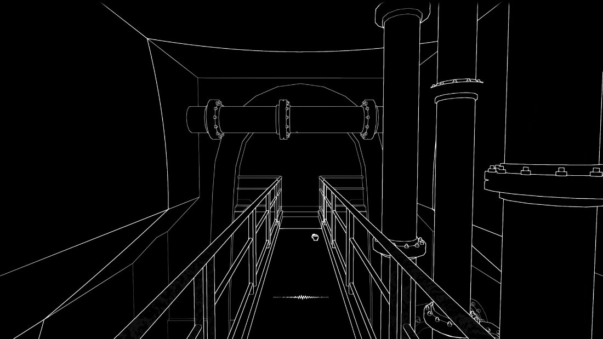
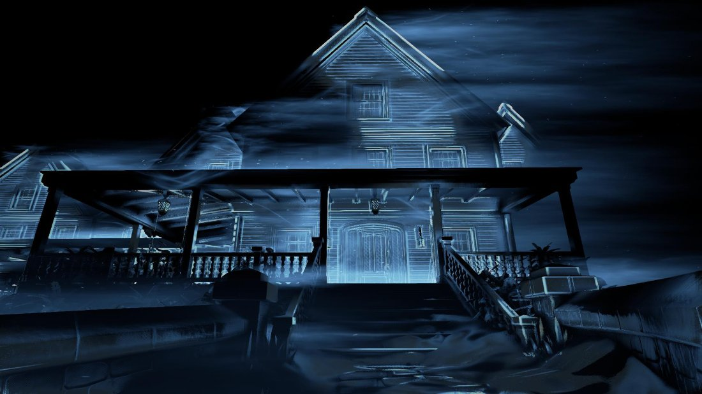
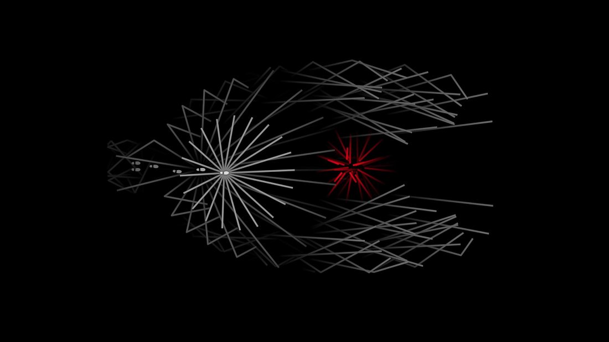
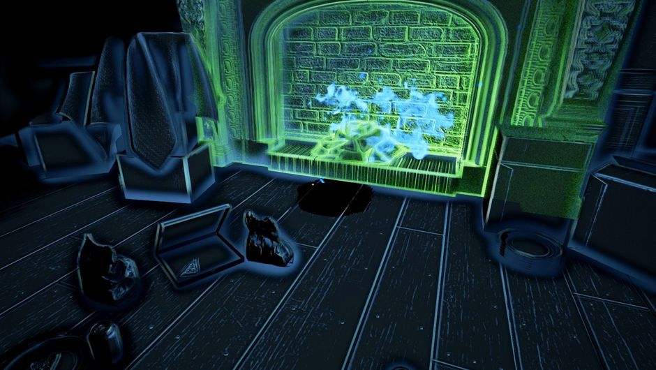

# רעש שמציל

**tagline: כדי לראות את הדרך, תצטרך להשמיע קול. אבל כל קול עלול להיות האחרון שלך.**

## מהות המשחק

"רעש שמציל" הוא משחק הישרדות, התגנבות וחשיבה דו־ממדי שבו השחקן לכוד במתקן מחקר חשוך ומנסה למצוא את היציאה. השחקן מפעיל גלי קול החושפים לזמן קצר את הסביבה — קירות, מעברים, חפצים ואויבים — אך הקול גם מושך אויבים לעבר מקור הרעש. במהלך השלבים יש לאסוף חפצי משימה, לפתוח דלתות ולהחליט מתי לחשוף את המפה ומתי להסתמך על הזיכרון. בהמשך אפשר להשתמש במכשירי רעש חד־פעמיים שמופעלים מרחוק כדי להסיח את דעת האויבים וליצור מסלול בריחה.

**פלטפורמה:** מחשב אישי (Windows), באמצעות מקלדת; משחק דו־ממדי במבט מלמעלה.

**ציור מסך של המשחק:** [להשלמה בהמשך — לפי בקשת הצוות, ציורי המסך אינם כלולים עדיין.]

---

## רכיבים רשמיים

### 1. שחקנים

המשחק מיועד לשחקן יחיד, בעיקר לבני נוער ומבוגרים מגיל 12 ומעלה האוהבים משחקי חשיבה, מתח והתגנבות. אין צורך בניסיון קודם: השלב הראשון מלמד את השליטה ואת ההיגיון של מערכת הקול. אין אינטראקציה שיתופית או תחרותית עם שחקנים אחרים; המשחק הוא שחקן מול הסביבה והאויבים הממוחשבים.

### 2. יעדים

**היעד הסופי:** לצאת ממתקן המחקר לאחר השלמת רצף שלבים.

**יעדים בכל שלב:** לחשוף חלקים מהמבוך; למצוא חפץ משימה כמו נתיך או מפתח; להפעיל את דלת החירום; להתחמק מאויבים; להגיע ליציאה מבלי להיתפס.

היעד מופיע כהודעה בתחילת השלב, למשל: "מצא את הנתיך ופתח את דלת החירום". התקדמות המשימה מוצגת בחלק העליון של המסך (למשל "נתיכים: 0/1"). לאחר איסוף הנתיך הכיתוב משתנה ל"הגע לדלת החירום". דלת היציאה מסומנת בסמל מיוחד כאשר נחשפת באמצעות גל קול.

### 3. תהליכים

#### תהליך ההתחלה — שלושים השניות הראשונות

- **0–10 שניות:** השחקן מתעורר בחדר חשוך; רק הדמות והשטח הצמוד אליה נראים. הודעה קצרה מבקשת ללחוץ על רווח. בלחיצה גל כחול חושף את קירות החדר ומעבר סמוך.
- **10–20 שניות:** השחקן נע עם החצים או מקשי WASD. לאחר שלוש שניות הקירות שנחשפו דוהים שוב; השחקן מבין שעליו לזכור את הדרך.
- **20–30 שניות:** בגל הבא מופיע צל של אויב במסדרון. האויב מתחיל לנוע אל הנקודה שממנה הופק הגל. השחקן נדרש לפנות למעבר צדדי ולהתחמק. כך המכניקה המרכזית מתבהרת דרך התנסות מיידית ולא הסבר ארוך.

#### תהליך הליבה — הפעולות החוזרות לאורך המשחק

1. השחקן מתקדם בזהירות במסדרון חשוך.
2. הוא בוחר בין גל קצר לגל חזק וחושף את סביבתו באופן זמני.
3. הוא מזהה קירות, חפצים, דלתות ומיקומי אויבים, ומתכנן את המסלול הבא.
4. אם אויב מגיב לרעש, השחקן משנה כיוון, מסתתר מאחורי קיר או משתמש במכשיר רעש להסחה.
5. השחקן אוסף את החפץ הדרוש ומגיע לדלת היציאה.

**דוגמה קונקרטית:** הנתיך נמצא בחדר המזרחי, ואויב שומר על הכניסה אליו. השחקן מפעיל גל כדי לזהות את שני המסדרונות. אחר כך הוא משליך מכשיר רעש לכיוון מערב; האויב עוזב את הכניסה לחדר ובודק את מקור הרעש. השחקן נכנס לחדר, אוסף את הנתיך וחוזר אל דלת החירום. בדרך חזרה עליו להחליט אם להרעיש שוב כדי לראות, או להתקדם לפי הזיכרון ולא למשוך את האויב חזרה.

**פקדים:**

| פקד | פעולה | תגובת המשחק |
|---|---|---|
| חצים או WASD | תזוזה | הדמות מתקדמת במסדרונות הפתוחים |
| רווח | גל קול קצר | האזור הקרוב נחשף; אויבים קרובים עשויים לשמוע |
| Shift + רווח | גל קול חזק | אזור גדול יותר נחשף אך האויבים שומעים ממרחק רב יותר |
| E | פעולה / איסוף | איסוף נתיך, שימוש בדלת וכדומה |
| Q | הפעלת מכשיר רעש | מכשיר חד־פעמי מושלך קדימה ומושך אויבים לנקודה אחרת |
| Esc | השהיה | פתיחת תפריט עצירה |

#### תהליך הסיום

כשהשחקן אסף את כל חפצי המשימה, הוא חוזר לדלת היציאה ולוחץ E. אם הדרישות הושלמו, הדלת נפתחת, מוצג מסך הצלחה והשחקן עובר לשלב הבא. אם אויב תופס אותו, מוצג מסך כישלון ואפשר לנסות את השלב מחדש. לאחר השלב האחרון נפתחת מעלית חילוץ והשחקן יוצא מהמתקן.

**איך לומדים את התהליכים?** ההדרכה מוצגת בהודעות קצרות בתוך השלב הראשון, ובכל פעם שמתגלה מכניקה חדשה מוצג רמז אחד בלבד. בשלבים מתקדמים ההדרכות נעלמות.

### 4. חוקים

- השחקן יכול לנוע רק בחדרים ובמסדרונות שאינם חסומים בקיר או בדלת נעולה.
- גל **קצר** חושף באופן זמני עצמים עד מרחק של **3 משבצות**; אויבים בטווח שמיעה של **4 משבצות** מגיבים למקור הקול.
- גל **חזק** חושף עצמים עד **7 משבצות**; אויבים בטווח שמיעה של **9 משבצות** מגיבים אליו.
- כל חשיפה דועכת אחרי **3 שניות**. בין הפעלת גל אחת לשנייה נדרשת המתנה של **2 שניות**.
- קירות חוסמים תנועה וראייה. בגרסה הראשונה, בדיקת השמיעה מתבססת על מרחק פשוט בין מקור הקול לאויב; אם נשפר את המערכת, נוכל להוסיף השפעה של קירות גם על הקול.
- כל אויב מסייר במסלול מוגדר. כאשר הוא שומע גל, הוא מתקדם למיקום שבו הגל הופק; אם הוא מגיע לשם ולא מוצא שחקן, הוא מחפש לזמן קצר וחוזר לסיור.
- מגע בין אויב לשחקן גורם לכישלון השלב.
- אפשר לפתוח דלת נעולה רק אם חפץ המשימה המתאים כבר נאסף.

**לימוד החוקים:** השלב הראשון מדגים גל קצר ותגובה של אויב, ובהמשך מוצגים הסברים קצרים על גל חזק ועל מכשירי רעש. טווחי הפעולה המספריים הם ערכי תכנון ראשוניים שיעברו איזון בבדיקות משחק.

### 5. משאבים

| משאב | כיצד משיגים אותו | התועלת | מדוע הוא מוגבל | איך מוצג לשחקן |
|---|---|---|---|---|
| גלי קול | יכולת בסיסית | חשיפת המפה | זמן טעינה של 2 שניות וסיכון למשיכת אויבים | מד טעינה ליד הדמות |
| מכשירי רעש חד־פעמיים | אוספים במקומות מוגדרים במבוך | הסחת אויבים למיקום אחר | כמות קטנה, למשל 1–2 בכל שלב | סמל ומונה בפינת המסך |
| מפתחות / נתיכים / כרטיסים | נמצאים בחדרי משימה | פתיחת היציאה או מעבר חסום | ממוקמים מאחורי אתגר או באזור מסוכן | רשימת משימות ומספר חפצים שנאספו |

### 6. עימותים

**שחקן מול המערכת:** חושך, קירות בלתי נראים עד להפעלת גל, דלתות נעולות, מסלולי סיור של אויבים ומגבלות זמן הטעינה של הקול.

**שחקן מול שחקנים אחרים:** אין עימות כזה, משום שזה משחק לשחקן יחיד.

**שחקן מול עצמו:** ההחלטה המרכזית היא האם להפעיל גל נוסף כדי לראות את הדרך או להמשיך בחושך כדי להישאר מוסתר. דילמה נוספת היא האם לבזבז מכשיר רעש נדיר עכשיו, או לשמור אותו לקראת אזור קשה יותר.

### 7. גבולות

**סוג העולם:** עולם **סגור ושטוח**, המוצג במבט דו־ממדי מלמעלה. לכל שלב מפה מוגדרת; הקצה שלה חסום בקירות ואין מעבר מהקצה הימני לשמאלי או להפך.

**הצגת הגבולות:** הקירות והגבולות נחשפים באופן זמני כאשר גל קול מגיע אליהם. חפצים חשובים ודלתות יכולים לקבל צבע מזהה.

**עקרונות תכנון המפה:**

- **משמעות:** חדרים ומעברים משרתים מטרות ברורות — חפץ משימה, אזור מעבר, נקודת הסחה או דרך בריחה.
- **ניידות:** קיימים מסלולים קצרים ומסוכנים לצד מסלולים ארוכים ובטוחים יותר; התנועה עצמה פשוטה ומהירה.
- **התמצאות:** לשחקן יש נקודות ציון, כגון דלתות בצבעים שונים, מספרי חדרים וחפצים בולטים שמתגלים בגלי קול.
- **עניין:** בכל שלב צורות חדרים שונות, דפוסי סיור חדשים ודרך אחרת לנצל את הרעש.
- **הכוונה:** בתחילת השלב מופיע יעד ברור; כאשר חפץ משימה נחשף הוא מסומן בצבע מיוחד, אך לא מוצג חץ קבוע המגלה את כל הדרך.

### 8. תוצאות

יש **שתי תוצאות עיקריות לכל שלב**: ניצחון (השגת החפצים והגעה ליציאה) או הפסד (תפיסה על ידי אויב). בסיום מוצלח ניתן להציג גם דירוג משני לפי זמן ההשלמה ומספר גלי הקול שהופקו.

התוצאה תלויה **בעיקר בכישרון**, בזיכרון, בתזמון ובתכנון. מסלולי אויבים ומיקומי משימות קבועים מאפשרים ללמוד מניסיונות קודמים, ולכן מרכיב המזל קטן.

זהו משחק לשחקן יחיד מול המערכת, **לא שיתופי ולא משחק סכום אפס בין שחקנים אנושיים**.

---

## סקירת משחקים קיימים

**ביטויי חיפוש:** `echolocation horror game`, `sound reveals environment game`, `sound-based stealth game`, `Stifled echolocation`, `Perception game`, `Dark Echo game`.

### 1. Stifled

**קישור:** https://store.steampowered.com/app/514830/Stifled/

**תיאור:** משחק אימה והתגנבות שבו קול חושף את העולם, אך גם מושך אויבים; יש בו אפשרות לשימוש במיקרופון.

**הדמיון:** הרעיון הבסיסי של "חייבים להרעיש כדי לראות, אך הרעש מסוכן" דומה מאוד לשלנו.

**ההבדל המתוכנן:** המשחק שלנו יהיה דו־ממדי, מבוסס שלבים קצרים וחידות של תכנון מסלול ושימוש מוגבל במכשירי הסחה, ולא משחק אימה תלת־ממדי הממוקד בחקירה ובחוויה קולית.

**צילום מסך:**

*צילום מסך מתוך Stifled (מקור: עמוד המשחק ב־Steam): העולם שחור לגמרי, ורק קול חושף את קווי המתאר של הסביבה; גל הקול מוצג בתחתית המסך. אצלנו אותו רעיון יוצג במבט דו־ממדי מלמעלה, כך שהשחקן יראה גם את האויבים שהרעש מושך ויוכל לתכנן מסלול.*

### 2. Perception

**קישור:** https://store.steampowered.com/app/426310/Perception/

**תיאור:** משחק מתח על אישה עיוורת המשתמשת בקול כדי להתמצא באחוזה; הרעשים עלולים למשוך ישות עוינת.

**הדמיון:** שימוש בקול לראייה והצורך לאזן בין חשיפה לסיכון.

**ההבדל המתוכנן:** במקום הרפתקת סיפור וחקירת אחוזה, המשחק שלנו יתמקד בפאזלים מערכתיים קצרים, חפצי משימה ודפוסי סיור שאפשר לנצל באופן מתוכנן.

**צילום מסך:**

*צילום מסך מתוך Perception (מקור: עמוד המשחק ב־Steam): האחוזה נחשפת בגוונים כחולים רק כשהדמות משמיעה קול. Perception הוא הרפתקת סיפור תלת־ממדית; המשחק שלנו יתמקד בשלבים קצרים עם חידות של מסלול, חפצי משימה ודפוסי סיור.*

### 3. Dark Echo

**קישור:** https://www.bunka.go.jp/j-mediaarts-festival/en/award/single/dark-echo/index.html

**תיאור:** משחק פאזל והישרדות מינימליסטי שבו קולות מוצגים כקווים, פוגעים במכשולים ומגלים את הסביבה החשוכה; רעש מושך סכנות.

**הדמיון:** הדמיית קול לצורך ניווט בחושך לצד איום של אויבים.

**ההבדל המתוכנן:** אנחנו מציעים מכשירי רעש להצבה/השלכה, דלתות התלויות בחפצי משימה ופתרון שלבים באמצעות תכנון הסחות דעת ומסלולים. יש לבדוק את מידת החידוש, מכיוון שגם במשחקים קיימים יש יכולות ליצירת רעש ולהסחה.

**צילום מסך:**

*צילום מסך מתוך Dark Echo (מקור: עמוד המשחק ב־Steam): הקול מוצג כקווים שמתפזרים מהשחקן, נפגעים בקירות וחושפים את המבנה, ואויב מסומן באדום. זה הדמיון החזותי הגדול ביותר למשחק שלנו; ההבדל יהיה במכשירי רעש שאפשר להציב ולהפעיל מרחוק כדי להזיז אויבים.*

### מדוע שחקנים יעדיפו את המשחק שלנו?

*תמונת המחשה לאווירה שאנחנו מכוונים אליה (צילום מסך ממשחק קיים בסגנון echolocation): החדר חשוך, וגל קול חושף לרגע את קווי המתאר של הקירות והחפצים. ב"רעש שמציל" החשיפה תהיה במבט דו־ממדי מלמעלה, ותראה גם את האויבים שהרעש מושך לעבר השחקן.*

אנחנו שואפים להציע משחק אסטרטגי קצר ונגיש: כל שלב הוא חידה שבה צריך לא רק לשרוד, אלא להשתמש במיקום מקור הקול כדי להשפיע על תנועת האויבים, לבחור נתיב ולהשיג את חפצי המשימה. זהו **בידול מתוכנן**, ולא טענה שהרעיון של ראייה באמצעות קול או הטעיית אויבים לא הופיע במשחקים אחרים.

### אילו רכיבים מדגישים את הייחוד?

- **תהליכים:** תכנון מסלול מראש וניהול מקורות רעש כדי להזיז אויבים ולאפשר מעבר בטוח.
- **משאבים:** מכשירי רעש חד־פעמיים שצריך לנצל במשורה.
- **עימותים:** הצורך לחשוף את הסביבה בלי למשוך אויבים אל השחקן, לצד האפשרות להפוך את הסיכון לכלי אסטרטגי.

